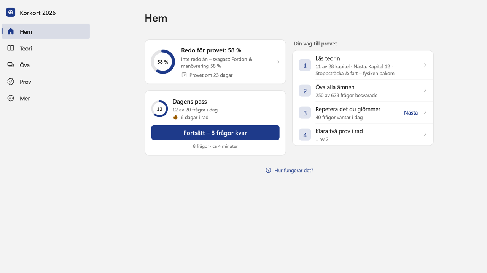
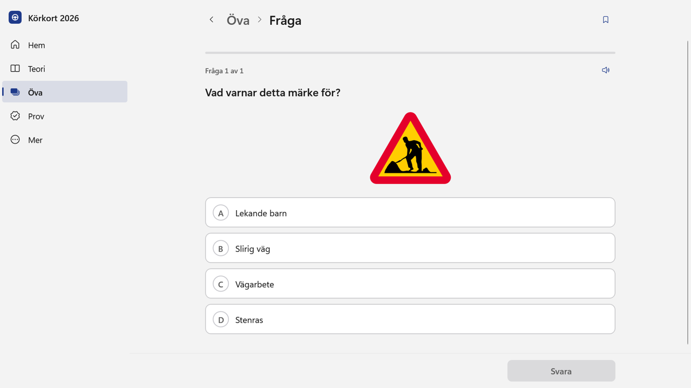
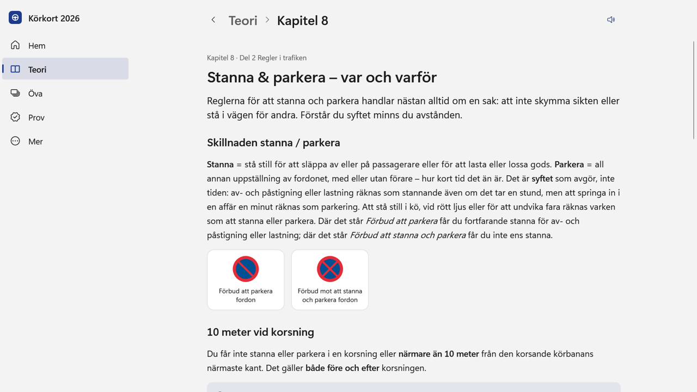
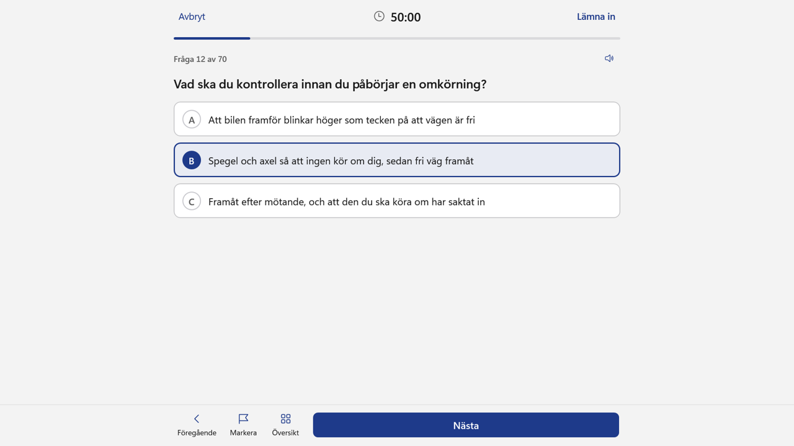
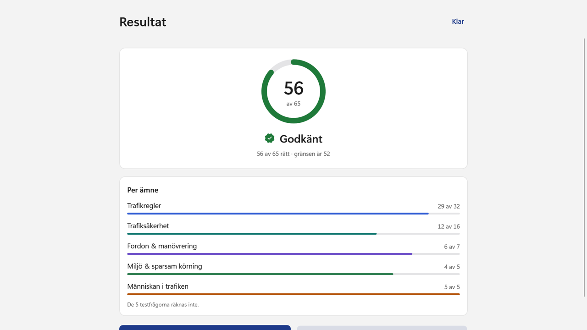
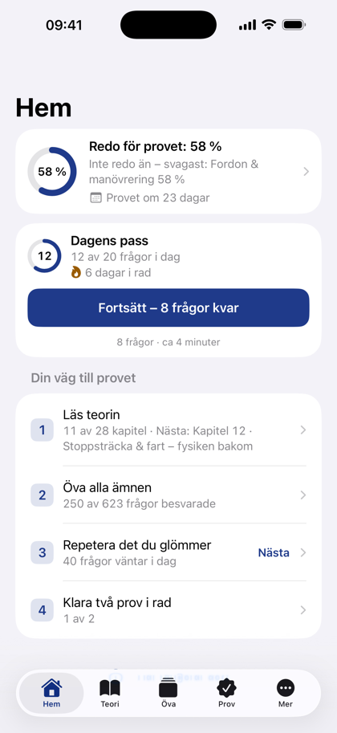
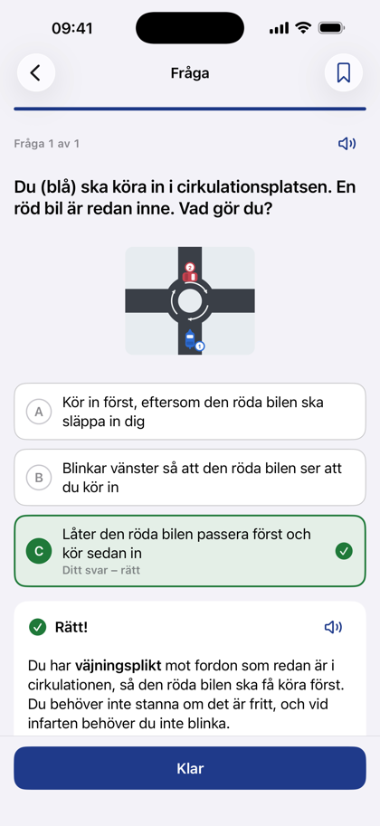
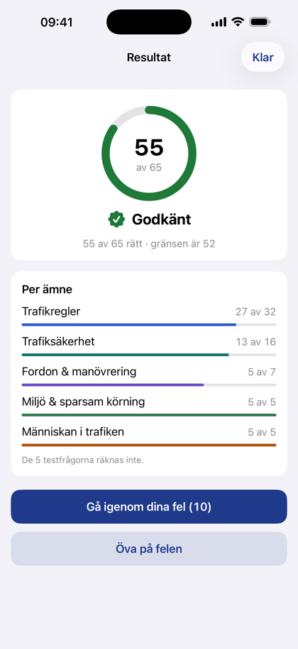

# Körkort 2026

**Plugga till teoriprovet för B-körkort i lugn och ro** — för Windows och iPhone. Webbplats:
**[korkortsplugg.se](https://korkortsplugg.se)**

> **Gratis.** Ingen reklam, inget konto och inga köp — och allt fungerar utan internet. Berätta gärna vad som
> fungerar och vad som kan bli bättre, se [Synpunkter och felrapporter](#synpunkter-och-felrapporter).
> Appens källkod är inte publik.

## Ladda ner

- **Windows 11:** ladda ner `Korkort2026-Setup-<version>.exe` under
  **[Releases](https://github.com/exxel-sudo/korkort2026/releases/latest)** och kör den. Windows kan visa
  *"Windows skyddade datorn"* eftersom programmet är nytt och inte kodsignerat: klicka **Mer info → Kör ändå**.
  Programmet uppdaterar sig självt när en ny version kommer.
- **Microsoft Store:** kommer snart — där installeras appen utan varning och uppdateras av sig själv.
- **iPhone:** kommer snart till App Store (iOS 16 eller senare).

## Vad appen gör

- **Läs teorin** — 28 kapitel i fem delar, från väjningsregler och hastighet till halka, alkohol och första hjälpen.
  Varje kapitel slutar med ett kort test.
- **Öva med 623 frågor** — egenskrivna övningsfrågor med en förklaring till varje svar. Svarsalternativen blandas
  varje gång, så att du lär dig svaret och inte platsen.
- **Repetera det du glömmer** — appen tar tillbaka frågor du är på väg att glömma. Under *Mina fel* samlas frågorna du
  svarat fel på, och *Dagens pass* väljer frågor åt dig.
- **Skriv prov på tid** — samma upplägg som kunskapsprovet: 70 frågor på 50 minuter, 52 rätt av de 65 som räknas.
  Efteråt går du igenom dina fel, fråga för fråga.
- **Vägmärken** — 50 vägmärken med förklaring och ett vägmärkestest för varje grupp.
- **Redo för provet** — visar hur nära du är och vilket ämne som är svagast, och räknar ned till ditt provdatum.
- **För alla** — uppläsning med svensk röst, ordlista, ljust och mörkt läge, stor text och tangentbord
  (Ctrl+1–5 byter flik, siffror eller bokstäver väljer svar och Enter går vidare).

| Windows | |
|---|---|
|  |  |
|  |  |

| iPhone | | |
|---|---|---|
|  |  |  |

## Dina uppgifter stannar hos dig

Appen samlar inte in några uppgifter: inget konto, ingen statistik, ingen spårning och ingen reklam. Dina svar, din
statistik och dina inställningar sparas bara på din dator eller telefon. Den enda gången appen själv använder nätet är
när den ser efter om det finns en ny version. Hela integritetspolicyn:
[korkortsplugg.se/integritetspolicy](https://korkortsplugg.se/integritetspolicy/).

## Om innehållet

Frågorna och teorin är eget övningsmaterial skrivet utifrån de svenska trafikreglerna — inte provets riktiga frågor.
Innehållet granskades i oktober 2026. Körkort 2026 är en fristående studieapp och är inte kopplad till Trafikverket
eller Transportstyrelsen. Vägmärkena är de svenska vägmärkena (allmänna handlingar) via Wikimedia Commons.

## Synpunkter och felrapporter

Hittar du ett fel i en fråga, något som inte fungerar eller har en idé: öppna
**[Issues](https://github.com/exxel-sudo/korkort2026/issues/new/choose)** och välj *Felrapport* eller *Förslag*. Se
[FEEDBACK.md](FEEDBACK.md). Du kan också mejla **support@korkortsplugg.se** eller trycka på **Rapportera fel** under
förklaringen i appen.

En säkerhetsbrist rapporteras privat, se [SECURITY.md](SECURITY.md).

## Licens

Gratis att använda. Källkoden är inte publik. Se [LICENS.md](LICENS.md).

Copyright © 2026 Nader
